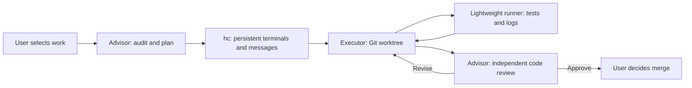

# Herdr Improve Skill — hc Multi-Agent Orchestration

[简体中文](README.md) · English

An experimental multi-agent orchestration skill for codebase audits, implementation plans, and code review. It combines [hc, the Herdr terminal runtime](https://github.com/herdrdev/herdr-core), with [shadcn/improve](https://github.com/shadcn/improve) to coordinate AI coding agents through persistent terminals and Git worktrees.

It keeps improve's auditing, specification, planning, and review workflow, while using hc's persistent terminals, messaging, and human takeover for subagent collaboration. The advisor makes judgments, executors implement changes, and the user decides what to merge.

The project is **Herdr Improve Skill**. The installed skill is **`improve-hc`**.

## Multi-agent audits, implementation, and code review

- Surveys repositories, verifies findings, and writes self-contained plans with verification criteria.
- Launches user-selected agents and models through hc rather than a host's native subagent API.
- Runs plans in separate Git worktrees, allowing independent tasks with non-overlapping scopes to proceed concurrently.
- Preserves executor terminals and context for specific review feedback, with at most two revision rounds.
- Delegates noisy tests, builds, or typechecks to lighter verification agents; full output stays in logs, while short results and paths return to the owner.
- Provides `hc attach` for human handling of permission or trust prompts.
- Reconciles plan status and reports leftover terminals and worktrees.

There is no additional scheduler service, adapter, configuration parser, or glue script. Runtime handoffs use plan files and `hc send`.

## Install the improve-hc Agent Skill

### Prerequisites

1. Install Git and a working [hc](https://github.com/herdrdev/herdr-core#install). Use `hc --help` and `hc --skill` for the installed CLI and agent manual.
2. Have at least one agent CLI that hc can launch interactively, with its own authentication and model configuration already working.
3. Use a host that supports Agent Skills. The `npx` installation below also requires Node.js and npm.

### With the Skills CLI

```sh
npx skills add Slone123c/herdr-improve-skill --skill improve-hc
```

Choose the target host when prompted. For a global installation:

```sh
npx skills add Slone123c/herdr-improve-skill --skill improve-hc --global
```

See the [Skills CLI reference](https://github.com/vercel-labs/skills/blob/main/docs/commands.md) for installer options. If your host is not supported by the installer, use the manual method below.

### Manual installation

Copy the entire `skills/improve-hc/` directory, not just `SKILL.md`. For example, to install into agy's user skill directory:

```sh
git clone https://github.com/Slone123c/herdr-improve-skill.git
cd herdr-improve-skill
mkdir -p ~/.gemini/skills
cp -R skills/improve-hc ~/.gemini/skills/
```

Back up an existing installation before replacing it. For another host, use that host's skill directory. Start a new session and confirm that `improve-hc` is available. Hosts with slash invocation can use `/improve-hc`.

### Optional hc role templates

The skill includes two examples:

```text
skills/improve-hc/assets/hc-templates/
  improve-hc-audit.md
  improve-hc-executor.md
```

To launch them by template name, place them in hc's template directory, `~/.config/herdr-core/templates/`. Compare existing files before replacing them. Their example `pi` commands use that program's configured default model; change them to your actual interactive launch commands if desired.

Templates are optional. Without a matching template, the advisor launches the chosen agent directly through hc, confirms readiness, and sends the role instructions and full task.

## Run coding agents through hc

Start the advisor in hc from your target project. This example uses agy; another interactive agent can be substituted:

```sh
cd /path/to/your/project
hc run --bg --name advisor --cwd "$PWD" agy
hc attach advisor
```

In the advisor session, use `/improve-hc` followed by a task in ordinary language. No subcommand selection is needed:

```text
/improve-hc Summarize this project's architecture and business flows
/improve-hc Check the login module for security risks
/improve-hc Write a plan for cache invalidation; do not implement yet
/improve-hc Review the previous cache plan and check its readiness
/improve-hc Carry out plan 003 and verify the result
/improve-hc Fix duplicate orders caused by repeated submissions
/improve-hc Continue unfinished work and check for leftover terminals
```

The skill routes the request to reconnaissance, auditing, planning, execution, review, or reconciliation using the goal, context, and existing plans. An explicit implementation request proceeds through any necessary plan, hc execution, and independent review. A broad improvement goal starts with investigation rather than arbitrary edits. Limits such as “summary only,” “plan first,” and “do not implement” are preserved. A bare plan reference triggers reading/review, not automatic execution. Legacy shortcuts such as `quick`, `plan`, `execute`, and `reconcile` remain compatible.

Choose the advisor's agent/model when starting its session. Select child agents and models in natural language, by task type or individual plan:

```text
Use my existing reviewer template for audits.
Use my selected agent/model for implementation, with a different pair for plan 003.
Use a lighter agent for test checks; return only exit status, a failure summary, and the log path.
```

There is no brand allowlist for agents or models, but each selection must be launchable through its real CLI arguments. Persistent execution and revision require interactive mode; a print-and-exit process cannot retain executor context. Agents that report OSC 7501 status provide fuller blocked/error handling. Automatic status detection may be limited for other agents.

## Collaboration workflow



`improve-hc` is the skill invocation name; `herdr-improve-skill` is the repository name. No changes to hc itself are needed. Advisors, executors, and verification runners continue to use their own CLI agent/model settings.

## Boundaries and experimental status

- The advisor does not edit source directly. Separate executors make changes in assigned worktrees.
- Review approval is not a merge. The advisor hands over branches and worktrees; the user decides what to merge.
- Worktrees isolate changes, not operating-system permissions. Permissions remain controlled by the selected CLI and environment.
- Verification agents run assigned checks, save logs, and report. Their owning executor or advisor remains responsible for fixes and judgments.
- CLI arguments, permission flows, and status reporting vary. This is an experimental integration, not a claim that every agent/model combination has been validated.
- Generated `plans/`, `advisor-plans/`, reports, and local logs belong to the user's workspace and are not distributed with this project. The skill's plan template and audit playbook remain part of the installation.

## Attribution and license

Built on the advisor and planning workflow from [shadcn/improve](https://github.com/shadcn/improve), using hc terminals from [herdr-core](https://github.com/herdrdev/herdr-core). This is an independent experiment, not an official integration from either upstream project.

Licensed under the [MIT License](LICENSE), retaining the upstream copyright notice.
