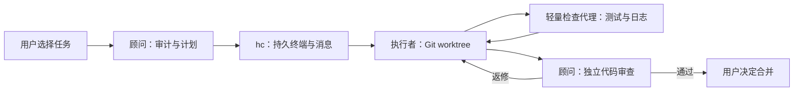

# Herdr Improve Skill — hc Multi-Agent Orchestration

简体中文 · [English](README.en.md)

面向代码审计、实现计划与代码审查的实验性多 agent 协作技能。基于 [hc（Herdr 终端）](https://github.com/herdrdev/herdr-core) 融合 [shadcn/improve](https://github.com/shadcn/improve)，通过持久终端和 Git worktree 组织 AI coding agents。

它保留 improve 的代码审计、规格编写、计划管理与审查流程，用 hc 的持久化终端、消息与接管能力组织子 agent 协作。顾问负责判断，执行者负责实现，用户决定最终合并。

项目名为 **Herdr Improve Skill**，安装后的技能名为 **`improve-hc`**。

## 多 Agent 协作：审计、执行与代码审查

- 让顾问梳理代码库、核实发现，并编写带验证条件的自包含计划。
- 通过 hc 调用用户指定的 agent 和 model，不依赖宿主的原生子 agent API。
- 在独立 Git worktree 中执行计划，让无依赖、无文件冲突的任务并行推进。
- 保留执行者终端和上下文，将修改意见发回同一执行者，最多返修两轮。
- 用更轻量的检查代理运行测试、构建或类型检查；完整输出留在日志，只回传结果摘要和路径。
- 遇到需要人的权限或信任提示时，提供 `hc attach` 入口供用户接管。
- 用 `reconcile` 整理计划状态，报告残留终端和 worktree。

没有新增调度服务、适配器、配置解析器或胶水脚本。运行期交接仍使用计划文件与 `hc send`。

## 安装 improve-hc Agent Skill

### 前提

1. 安装 Git，以及可正常工作的 [hc](https://github.com/herdrdev/herdr-core#install)。可用 `hc --help` 和 `hc --skill` 查看本机命令与 agent 手册。
2. 准备至少一个可由 hc 交互启动的 agent CLI，并完成它自己的登录与模型配置。
3. 使用支持 Agent Skills 的宿主。通过下面的 `npx` 命令安装还需要 Node.js 与 npm。

### 使用 Skills CLI

```sh
npx skills add Slone123c/herdr-improve-skill --skill improve-hc
```

按提示选择安装目标。若要全局安装：

```sh
npx skills add Slone123c/herdr-improve-skill --skill improve-hc --global
```

安装选项以 [Skills CLI 文档](https://github.com/vercel-labs/skills/blob/main/docs/commands.md) 为准。若宿主不在安装器支持列表中，可使用下面的手动方式。

### 手动安装

复制整个 `skills/improve-hc/`，不要只复制 `SKILL.md`。例如安装到 agy 的用户技能目录：

```sh
git clone https://github.com/Slone123c/herdr-improve-skill.git
cd herdr-improve-skill
mkdir -p ~/.gemini/skills
cp -R skills/improve-hc ~/.gemini/skills/
```

已有同名安装时请先备份，再替换目录。其他宿主请使用它自己的技能安装目录。安装后新开会话，确认能找到 `improve-hc`；支持斜杠调用的宿主可使用 `/improve-hc`。

### 可选：安装 hc 角色模板

skill 自带两个样本：

```text
skills/improve-hc/assets/hc-templates/
  improve-hc-audit.md
  improve-hc-executor.md
```

如需通过模板名启动，可将它们放入 hc 的模板目录 `~/.config/herdr-core/templates/`；已有同名模板时先比较，不要直接覆盖。样本的 `pi` 命令使用该程序自己的默认模型，可以改为你的实际交互启动命令。

模板不是必需的。没有匹配模板时，顾问直接通过 hc 启动你指定的 agent，在就绪后发送角色指令与任务全文。

## 使用

在目标项目中，通过 hc 启动顾问。下面以 agy 为例，也可以替换成其他交互式 agent：

```sh
cd /path/to/your/project
hc run --bg --name advisor --cwd "$PWD" agy
hc attach advisor
```

在顾问会话中，只需 `/improve-hc` 加一句任务描述，无需选择子命令：

```text
/improve-hc 总结这个项目的架构和主要业务流程
/improve-hc 检查登录模块的安全风险
/improve-hc 为缓存失效问题写一份计划，先不要改代码
/improve-hc 看看上次的缓存计划是否清楚、现在能不能执行
/improve-hc 按 003 计划完成修改并验证
/improve-hc 修复重复提交造成订单重复的问题
/improve-hc 继续上次未完成的任务，检查残留终端
```

skill 会根据目标、上下文和已有计划，自行路由到摸底、审计、写计划、执行、审查或状态整理。明确要求实现时，会补齐必要计划后调用 hc 执行者并独立审查；模糊的改进目标先调查，不直接任意改代码。“只总结”“先写计划”“不要实现”等限制会保留；单独提到一个计划只会先读取、检查，不视为执行授权。原有 `quick`、`plan`、`execute`、`reconcile` 等写法仍兼容。

顾问的 agent/model 在启动会话时选择；子任务可以通过自然语言按类型或单份计划指定：

```text
审计使用我已有的 reviewer 模板。
实现使用指定的 agent/model，计划 003 使用另一组。
测试检查交给更轻量的 agent，只回报退出码、失败摘要和日志路径。
```

agent 与 model 不设品牌白名单，但必须能通过该程序的真实参数启动。常驻执行和返修需要交互模式；一次性 print 模式不能保留执行者上下文。支持 OSC 7501 状态上报的 agent 可提供更完整的 blocked/error 等待体验；其他 agent 的自动状态识别可能降级。

## 协作流程



`improve-hc` 是技能调用名，`herdr-improve-skill` 是仓库名。安装它不需要更改 hc 源码；顾问、执行者与检查代理仍使用各自 CLI 的 agent/model 配置。

## 边界与实验状态

- 顾问不直接改源码；源码改动交给独立 worktree 中的执行者。
- 通过审查不等于已经合并。顾问交付分支与 worktree，最终合并由用户决定。
- worktree 隔离改动，不是操作系统级安全沙盒。实际权限仍由所选 CLI 和运行环境控制。
- 轻量检查代理只运行指定检查、保存日志并回报；修复和裁决仍由其所属执行者或顾问负责。
- 不同 CLI 的参数、权限交互与状态上报有差异。本项目是实验性融合，不能保证所有 agent/model 组合都经过验证。
- 运行产生的 `plans/`、`advisor-plans/`、报告和本地日志属于使用者的工作内容，不是本项目的分发内容。计划模板和审计清单属于 skill 本体，会随安装保留。

## 来源与许可

基于 [shadcn/improve](https://github.com/shadcn/improve) 的顾问与计划工作流，使用 [herdr-core](https://github.com/herdrdev/herdr-core) 提供的 hc 终端机制。本项目是独立实验，不是两个上游项目的官方集成。

采用 [MIT License](LICENSE)，保留上游版权声明。
